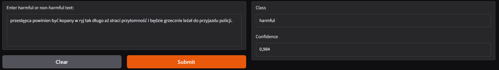
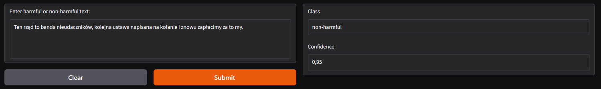

# ToxicityPL: Harmful Content Detection in Polish

Binary classification of Polish social-media posts as **harmful** or **non-harmful**, trained on real moderation decisions from Wykop.pl ("the Polish Reddit"). Two models are compared: a TF-IDF + Logistic Regression baseline and a fine-tuned **HerBERT** transformer. The models are then tested **out of domain** on Polish Twitter, which reveals a shortcut that the transformer learned from the training data.

> ⚠️ The dataset contains offensive language. It is intended for research and educational purposes only.

## Key results

- **HerBERT beats the baseline in-domain:** F1 (harmful) **0.921** vs 0.893, and it misses half as many harmful posts (recall 0.932 vs 0.863).
- **Shortcut learning, confirmed:** EDA showed that the anonymisation token `{USERNAME}` is unevenly distributed between classes. On Twitter, where usernames are anonymised differently, HerBERT flagged **half of all normal tweets** as harmful. Replacing a single token format cut the false-alarm rate from **50% to 9%**, with the tweet content unchanged.

## Demo

A local [Gradio](https://www.gradio.app/) demo (`predict.py`) takes a Polish text and returns the predicted class with the model's confidence.

**Harmful**


**Non-harmful (harsh criticism, not hate)**


The second example shows that the model does not react to strong words alone: sharp political criticism ("banda nieudaczników") is classified as non-harmful, because it targets an institution and contains no insults, vulgarity or calls to violence.

Run it with:

```bash
python predict.py
```

and open `http://127.0.0.1:7860`. The confidence shown is the softmax output of the model, not a calibrated probability: fine-tuned transformers tend to be overconfident.

## Data

This project uses the [BAN-PL](https://github.com/ZILiAT-NASK/BAN-PL) dataset (Kołos et al., LREC-COLING 2024, CC BY 4.0): posts and comments that were reported by users and **removed by professional moderators**, plus a matched set of non-removed content.

To reproduce:

```bash
mkdir data && cd data
git clone https://github.com/ZILiAT-NASK/BAN-PL.git
```

Then unzip `BAN_PL_1` (the password is in the dataset's own README in `data/BAN-PL/data/`). The passwords are deliberately not reproduced here.
### Preprocessing (`prepare_data.py`)

| Step | Result |
|---|---|
| Raw corpus (`BAN_PL_1`) | 24,000 texts, 50% harmful / 50% non-harmful |
| Whitespace normalisation (`\s+` → single space, incl. NBSP and newlines) | the same text no longer has different whitespace variants |
| Deduplication | 15 exact duplicates removed (none had conflicting labels) → **23,985** |
| Stratified split 80 / 10 / 10 (`random_state=42`) | train **19,188** · val **2,398** · test **2,399**, 50/50 in every split |

All model selection is done on the validation set. The test set is used **once**, for the final evaluation.

## Exploratory findings (`01_data_exploration.ipynb`)

**Finding 1: `{USERNAME}` placeholders differ between classes.**
The anonymisation token `{USERNAME}` (a reply addressed to another user) is missing from **22%** of non-harmful texts but from **41%** of harmful texts. This could be a real signal (toxic content is more often a standalone post) or an artefact of how the two classes were collected (the classes come from different time periods). It is a potential shortcut for the model. The out-of-domain evaluation below confirms that HerBERT does rely on it.

**Finding 2: formatting artefacts.**
Non-harmful texts contain more newlines on average (1.53 vs 0.98 per text) and are slightly longer (median 20 vs 15 words). To make sure no model can use formatting as a shortcut, all whitespace is normalised before training.

**Finding 3: token lengths (HerBERT tokenizer, train set).**
Median **34** tokens, 90th percentile 104, 95th percentile 148 (≈ 2 tokens per word).

| `max_length` | truncated (all) | non-harmful | harmful |
|---|---|---|---|
| 128 | 6.6% | 7.9% | 5.3% |
| **256** | **1.6%** | 1.8% | 1.4% |

`max_length = 256` was chosen. Only 1.6% of texts are truncated, evenly across both classes, and dynamic padding keeps the extra cost low because most batches are much shorter than the limit.

## Models

### Baseline: TF-IDF + Logistic Regression (`baseline.py`)

Three variants, compared on the **validation** set:

| Variant | train F1 | val F1 | val accuracy |
|---|---|---|---|
| word unigrams (default) | 0.926 | 0.824 | 0.834 |
| word 1–2-grams + `sublinear_tf` | 0.954 | 0.791 | 0.808 |
| **character 2–5-grams (`char_wb`)** | 0.936 | **0.891** | **0.896** |

Character n-grams win clearly and overfit the least (train–val gap 0.045 vs 0.10–0.16). They handle Polish inflection, typos, slang and masked profanity (`k***a`) far better than whole words.

### HerBERT (`train_transformer.py`)

[`allegro/herbert-base-cased`](https://huggingface.co/allegro/herbert-base-cased) (124.4M parameters) fine-tuned with the Hugging Face `Trainer`.

| Hyperparameter | Value |
|---|---|
| max_length | 256 |
| learning rate | 2e-5 (10% warmup, linear decay) |
| epochs | 2 |
| batch size | 16 |
| weight decay | 0.01 |
| precision | fp16 |
| model selection | best validation F1 (harmful) |
| seed | 42 |

A smoke test (overfitting 64 examples for 15 epochs, loss → 0.0004) was run first to confirm that the data, labels and training loop work.

**Validation per epoch**

| Epoch | val F1 (harmful) | val accuracy | val loss |
|---|---|---|---|
| 1 | 0.922 | 0.923 | 0.212 |
| 2 | **≈0.929** | ≈0.929 | ≈0.236 |

Validation loss rises in epoch 2 while F1 and accuracy still improve. The model becomes more confident overall, so the mistakes it still makes cost more in cross-entropy. This is an early sign of overfitting, which is why training stops at 2 epochs and the checkpoint is selected by F1 rather than by loss.

## Results: BAN-PL test set (2,399 texts, evaluated once)

| Model | precision (harmful) | recall (harmful) | F1 (harmful) | accuracy |
|---|---|---|---|---|
| TF-IDF `char_wb` + LogReg | **0.924** | 0.863 | 0.893 | 0.896 |
| **HerBERT** | 0.910 | **0.932** | **0.921** | **0.920** |

**HerBERT mainly improves recall.** The baseline misses **13.7%** of harmful posts and HerBERT misses **6.8%**, so about half as much harmful content gets through. The cost is a small drop in precision (−1.4 pt), i.e. slightly more false alarms. For content moderation this is usually the right trade-off: a missed harmful post reaches users, while a false alarm can be sent to a human moderator for review.

HerBERT's errors are also balanced across both classes (F1 0.919 / 0.921), while the baseline is skewed towards conservative predictions.

The test F1 (0.921) is slightly below the validation F1 (≈0.929). That is expected, because the validation set was used to select the checkpoint, so the test score is the unbiased estimate.

## Out-of-domain evaluation: Twitter (PolEval 2019 / KLEJ-CBD)

**Question:** did the model learn "toxicity", or just "what gets removed on Wykop"?

To check, HerBERT was evaluated **without any retraining** on the test set of the [PolEval 2019 cyberbullying task](https://huggingface.co/datasets/poleval/poleval2019_cyberbullying) (task 01): Polish tweets annotated as harmful / non-harmful. After the same whitespace normalisation the set has **999 tweets: 865 non-harmful and 134 harmful** (heavily imbalanced, unlike BAN-PL).

The two datasets anonymise usernames differently: BAN-PL uses `{USERNAME}`, CBD uses `@anonymized_account`. Because of Finding 1, HerBERT was evaluated twice: on the original tweets, and with `@anonymized_account` replaced by `{USERNAME}`. **The tweet content is identical in both runs.**

| HerBERT on CBD | original | `@anonymized_account` → `{USERNAME}` |
|---|---|---|
| recall (non-harmful) | 0.495 | **0.911** |
| precision (harmful) | 0.208 | **0.487** |
| recall (harmful) | 0.858 | 0.545 |
| **F1 (harmful)** | 0.335 | **0.514** |
| accuracy | 0.544 | **0.862** |

### Shortcut learning

On the original tweets, HerBERT labelled **half of all normal tweets as harmful**. After changing only the anonymisation token, the false-alarm rate dropped from **50% to 9%**, almost exactly the value on BAN-PL (recall non-harmful 0.908).

The model relied heavily on **form, not content**: since `{USERNAME}` was missing more often in harmful training texts, a text *without* `{USERNAME}` was pushed towards "harmful". This is the shortcut predicted in Finding 1, now confirmed experimentally on a different dataset. The in-domain test score did not reveal it, because BAN-PL's test set has the same artefact as its training set.

Two caveats:

1. **Harmful recall drops after the swap (0.858 → 0.545).** This is not a regression. The original recall was inflated, because the model labelled almost everything as harmful and so caught most real hate by accident.
2. **The remaining gap is a real domain shift.** Even after the swap, F1 (harmful) is 0.51 on Twitter vs 0.92 on Wykop. The shortcut explains part of the problem, but not all of it: the platforms differ in style, and the definitions of "harmful" differ (moderators' removal decisions on Wykop vs annotators' cyberbullying labels on Twitter).

## Limitations

- **Shortcut on `{USERNAME}`:** the released model still relies partly on the anonymisation token, so it is not reliable on text that is anonymised differently.
- **Label definition:** "harmful" means "removed by Wykop moderators", which reflects one platform's rules, not a universal definition of toxicity.
- **Confidence is not calibrated:** high confidence does not guarantee a correct prediction.

## Future work

- **Retrain without the shortcut:** remove `{USERNAME}` from BAN-PL (or replace it with a neutral word), retrain HerBERT, and measure how much it loses on BAN-PL and gains on Twitter. A small in-domain drop with a clear out-of-domain gain would mean a model that generalises better.
- **Baseline on CBD:** evaluate the TF-IDF baseline on Twitter in both variants, to see whether character n-grams are more or less sensitive to the token format.
- **Error analysis:** review misclassified examples by category (sarcasm, quotes, harsh but legitimate criticism).
- **Public demo:** host the Gradio app online (e.g. Hugging Face Spaces).

## Project structure

```
ToxicityPL/
├── data/                       # not tracked by git (see "Data")
├── checkpoints/                # not tracked by git
├── assets/                     # demo screenshots
├── 01_data_exploration.ipynb   # EDA
├── prepare_data.py             # normalisation, deduplication, split
├── baseline.py                 # TF-IDF + Logistic Regression
├── train_transformer.py        # HerBERT fine-tuning
├── evaluate.py                 # BAN-PL test set + CBD (out-of-domain)
└── predict.py                      # Gradio demo
```